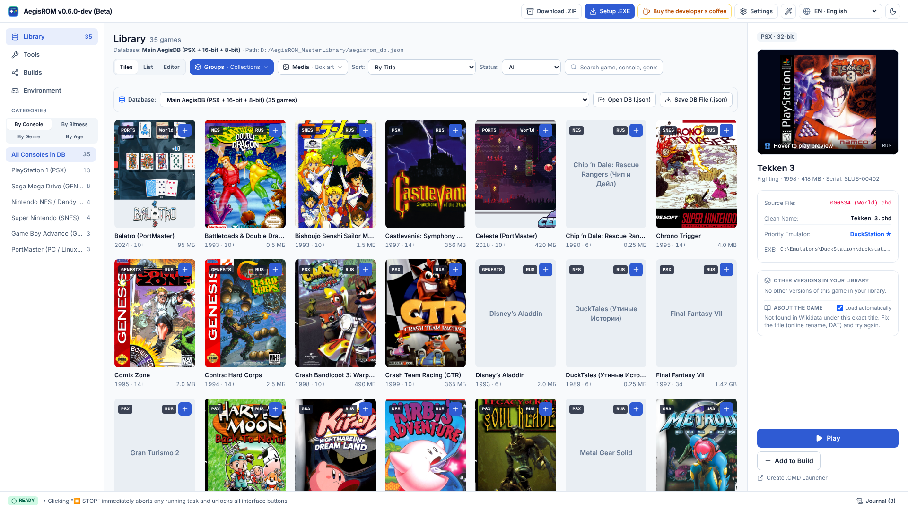
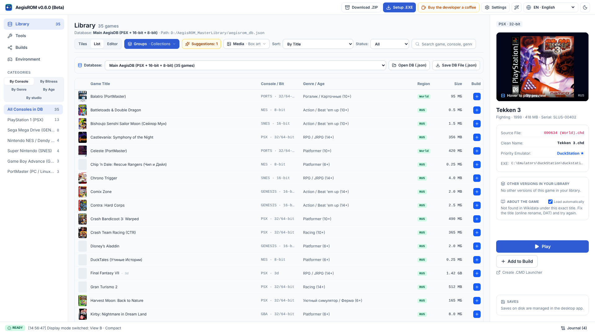
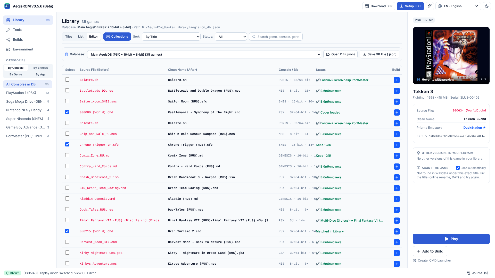
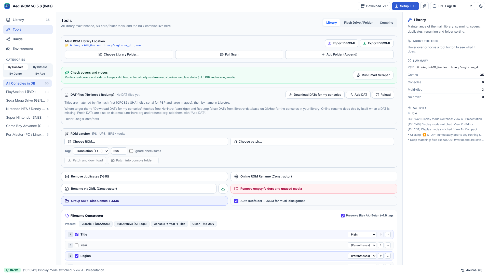
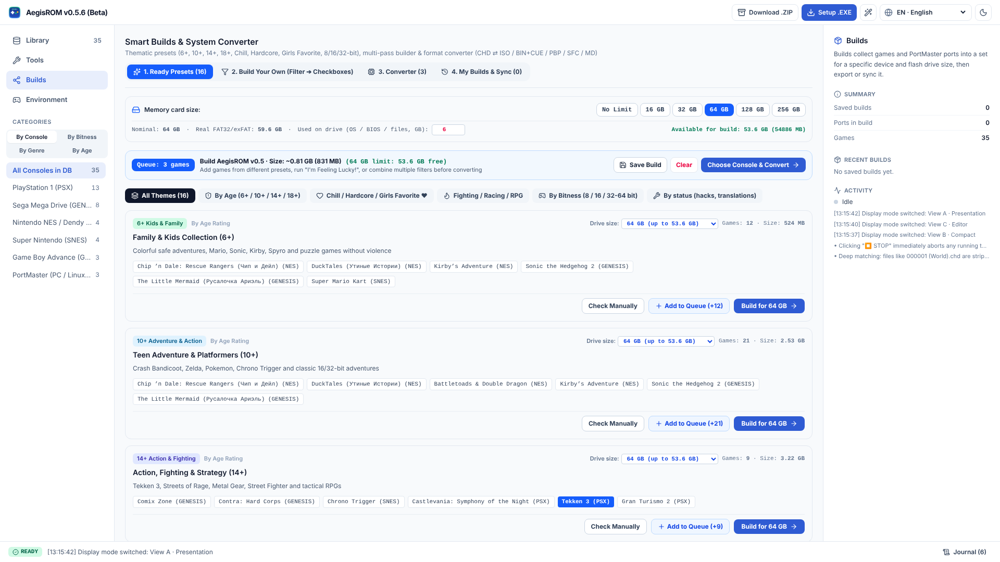
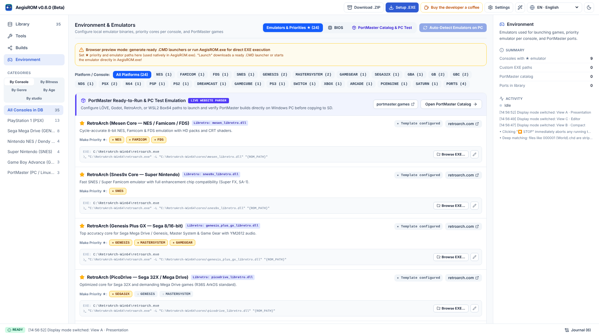
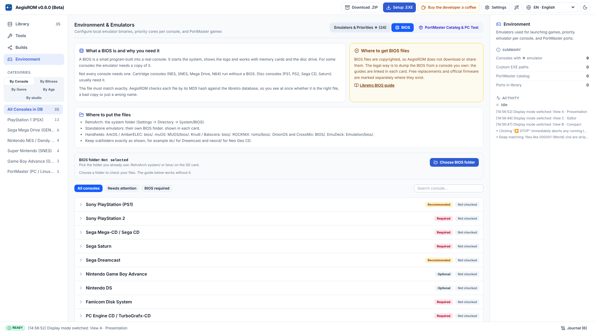

**English** · [Русский](README.ru.md)

# AegisROM

**ROM manager for retro consoles and handhelds.**
Tidies up your collection, removes duplicates, downloads box art and builds a ready-to-use SD card for your console.

[Download](https://github.com/wirgylle/AegisROM/releases) · [Features](#features) · [Installation](#installation) · [Quick start](#quick-start) · [FAQ](#faq) · [Roadmap](#roadmap)

---

## What is it

AegisROM is for anyone who owns a retro console or handheld (**R36S, Anbernic, Miyoo, Retroid, TrimUI, Steam Deck**) and has a ROM folder that is hard to make sense of.

The app scans your collection and identifies games by checksums and disc serial numbers, checking them against online databases or a prepared XML file (`gamelist.xml`). It then keeps one best version of each game, renames files, downloads box art and video previews, and finally builds an SD card of the size and folder layout you need.

## Features

### 📚 Library
- Three view modes: **Tiles** (box art gallery), **List** (dense list) and **Editor** ("before → after" comparison with checkboxes for bulk actions).
- Grouping by console, generation (8-bit, 16-bit, 32/64-bit, 128-bit+), genre and year.
- **Multi-disc games** (Final Fantasy VII, Metal Gear Solid, etc.) are shown as one game: discs go into a shared folder and an `.m3u` playlist is created.
- Game card with box art and video preview.
- Add a game to a build with a single `+` button.
- Save and open the library database so you don't have to rescan your drives.
- **Collections**: one game released on several consoles is shown as one group; the game card shows a description from Wikidata.
- **Play** `beta`: the built-in emulator (EmulatorJS) runs a game right in the app window, no emulator install needed. Sega CD and PC Engine CD take their BIOS from the BIOS section.

| List | Editor |
|---|---|
|  |  |

> Features marked `beta` are already in the app but still in development: they may not always work, or may not work as expected. If something is wrong, please report it in [Issues](https://github.com/wirgylle/AegisROM/issues).

### 🛠 Tools
- **Scanning** with identification by CRC32 (including headerless ROMs) and disc serial codes (`SLUS`, `SCES`, `SLPS`).
- **1G1R (one game, one ROM):** out of all versions of a game, the best one by your region priority is kept, for example `Russia → USA → Europe → Japan`.
- **Box art and video scraper** (Libretro, Archive.org). Finds empty placeholder images and re-downloads them, leaves good files alone.
- **Names by hash**: matching against No-Intro (cartridges) and Redump (discs) DAT files by CRC32 / SHA1, and by serial number for PBP and large images. A name found this way takes priority over online search, and its source is shown in the game card. How to add a DAT: [docs/dat.md](docs/dat.md).
- **Renaming**: by hash from a DAT, online search, `gamelist.xml` and ROM headers. Understands numbered files like `000001.chd`, as found on stock R36S cards.
- **File name builder**: title, region, language, translation author, disc number, extension case, `[T+Rus]` / `[Hack]` status tag.
- **Hacks and translations** `beta`: detected by name tags (`[T+Rus]`, `[h1]`, `(Hack)`), by DAT hash and by patches in `patch/`. 1G1R doesn't delete them as duplicates but offers to move them to `hackroms/`. The game card shows how a ROM differs from the original. Status filter and sort, "Russian translations only" and "No hacks" builds.
- **ROM patcher** `beta`: IPS, UPS, BPS and xdelta. Adds a `[T+Rus]` or `[Hack]` tag, puts the result in `hackroms/` and the patch in `patch/`. Details: [docs/hacks.en.md](docs/hacks.en.md) · [Русский](docs/hacks.md).
- **Cleanup** of junk: `._*` files, stray images, empty service folders.
- **SD card repair** for your firmware: restores the folder structure and clears the Dirty Bit flag for **ArkOS, AmberELEC, ROCKNIX, OnionOS, GarlicOS, muOS, Batocera / Knulli, EmuELEC, RetroDeck**.
- **Combine**: drop new ROMs into a buffer folder, and the app identifies, renames and sorts them into console folders by itself.

### 📦 Builds
- Ready-made themed collections: by age (6+, 10+, 14+, 18+), by mood, by genre and bitness. Or your own build via filters.
- Fitting to SD card size: 16, 32, 64, 128, 256 GB, leaving room for firmware and BIOS.
- Syncing a build with the main library, showing the differences.
- **Image converter**: `.cue/.bin`, `.iso`, `.gdi` → `.chd` (via `chdman`), plus `.pbp` and `.cso`.
- **PortMaster catalog** `beta`: list of ports with a "ready to run" / "needs files from Steam or GOG" filter and automatic placement into `ports/`.

### 🎮 Environment
- Choose an emulator per platform: RetroArch cores, DuckStation, PCSX2, RPCS3, PPSSPP, mGBA, melonDS, Ryujinx, Xemu.
- Auto-detection of emulators installed on the PC and launching a game right from its card `beta`.
- Checking PortMaster ports on the PC before copying them to the console `beta`.
- **BIOS**: a beginner guide to what each console needs, MD5 check against the libretro database and copying BIOS files into a build.

### 🌍 9 UI languages
Русский, English, Deutsch, Español, Français, Italiano, 日本語, Srpski (Latin), 简体中文. The language is detected automatically, with a switcher in the header.

## System requirements

| | |
|---|---|
| OS | Windows 11 x64 |
| Browser | Microsoft Edge or Google Chrome (the app window opens through it) |
| For `.chd` conversion | `chdman` from the MAME package |
| Internet | only needed for the box art scraper and the PortMaster catalog |

There are no Linux or macOS versions yet; they are planned.

## Installation

1. Open the [Releases](https://github.com/wirgylle/AegisROM/releases) page and pick the top (newest) release.
2. Download one of the files:

| File | What it is |
|---|---|
| `AegisROM-Setup-vX.Y.Z-Win11-x64.exe` | **Installer.** Recommended. Installs to `C:\Program Files\AegisROM`, creates shortcuts, removes old copies, migrates settings. |
| `AegisROM-Portable-Win11-x64.exe` | **Portable version** in a single file, no installation. |
| `AegisROM-vX.Y.Z-Win11-x64.zip` | Full archive with all components. |
| `aegis-scanner-win11-x64.exe` | Standalone command-line scanner for advanced users. |

3. Run the installer and follow the wizard.

> Windows SmartScreen may warn about an unknown publisher: the files are not signed yet. Click "More info" → "Run anyway".

You can uninstall the app via "Settings → Apps" or the uninstaller in the installation folder.

## Quick start

1. **Choose your ROM folder.** "Tools" → "Library" → pick the folder and start the scan.
2. **Set your region priority** and run **1G1R** to remove duplicates.
3. **Rename files** with the file name builder if you want consistent naming.
4. **Run the scraper** to download box art and videos.
5. **Build your SD card.** "Builds" → create a build for your card size, add games with the `+` button in the library and export to the SD card.
6. If the console doesn't see the card or reports errors, use **"SD card repair"** with your firmware's profile.

## FAQ

**Where do I get ROMs?**
AegisROM does not download or distribute games. Use copies of games you own.

**Does the app delete files?**
By default, duplicates found by 1G1R are moved to the `_Duplicates_1G1R` quarantine folder, not deleted. Permanent deletion is enabled by a separate checkbox.

**My R36S card has files named `000001.chd`, `000002.chd`… Is that supported?**
Yes. Renaming by `gamelist.xml` and headers parses these numbered files and gives them proper names back.

**Where do I get DAT files for hash matching?**
Press "Download DATs for my consoles" in "Tools": AegisROM fetches No-Intro and Redump DATs from libretro-database for the consoles in your library. Online rename does this by itself when a DAT is missing. You can also download DATs from [datomatic.no-intro.org](https://datomatic.no-intro.org) (cartridges) and [redump.org](http://redump.org/downloads/) (discs) and add them with "Add DAT". More in [docs/dat.md](docs/dat.md).

**Do I need internet?**
Only for downloading box art, videos and the PortMaster catalog. Scanning, 1G1R, renaming and builds work offline.

**Will there be a Linux / macOS / Steam Deck version?**
It's planned. Right now the app only runs on Windows 11.

**I found a bug or have an idea.**
Open an [Issue](https://github.com/wirgylle/AegisROM/issues) and describe what you did and what happened. A screenshot helps a lot.

## Roadmap

| Version | What's coming |
|---|---|
| **0.5.6** (released) | Hacks and patches module with an IPS/UPS/BPS/xdelta patcher, BIOS section with MD5 check, playing games in the app window, first-run setup wizard and tour, library collections, settings stored on disk. |
| **0.5.7 – 0.5.8** | Manual editing in Editor view (names, details, media paths), Series in the library (a whole game franchise), better online renaming, compressed xdelta patches. |
| **before 0.6.0** | The app's own window instead of Edge or Chrome, with settings stored on disk. A macOS version: one `.dmg` for Intel and Apple Silicon, games launched through Mac emulators. PortMaster on Windows through a Linux environment (WSL). |
| **0.6.0** | Save manager (`.srm`, `.state`, memory cards) with version history. First step is in `dev`: games from the built-in Play save as files next to the ROM. Uploading builds to the console over Wi-Fi (SFTP / SMB / WebDAV) without removing the card. |
| **0.7.0** | RetroAchievements: checking achievement support by ROM hash. PDF manuals, walkthrough maps and a soundtrack player in the game card. |

Details in [docs/ROADMAP.md](docs/ROADMAP.md) (in Russian). Plans may change.

## Support the developer

AegisROM is free. If it saves you time, you can buy the developer a coffee: the ☕ button in the app header opens a window with the addresses and QR codes. You can also send USDT directly:

| Network | USDT address |
|---|---|
| Tron (TRC-20) | `TJZJ6wqa3DSmN4JT4ndqYx2MGpqdsVxTE1` |
| Solana (SPL) | `DFV4HD6SCkFTEvtf5xU1mB7DTE5cKMBBHGftpLFWPG1s` |
| Arbitrum One, Avalanche C-Chain, Ethereum (ERC-20) | `0x2a959B2f486e7F1d033016A7c94796cF42e1eF0f` |

Send only USDT, and pick the same network in your wallet or exchange as in this table. Coins sent on another network are lost.
<!-- Addresses: src/data/donate.ts is the source; src/data/donate.test.ts checks this table matches it. -->

## For developers

Building from source, architecture and contribution rules are described in [docs/](docs/) and [CONTRIBUTING.md](CONTRIBUTING.md) (in Russian).

## License

No license has been chosen yet. Until then, all rights to the code belong to the author.
