

[English](README.md) · **Русский**

# AegisROM

**Менеджер ромов для ретро-консолей и портативок.**
Наводит порядок в коллекции, убирает дубли, качает обложки и собирает готовую флешку под вашу консоль.

[Скачать](https://github.com/wirgylle/AegisROM/releases) · [Возможности](#возможности) · [Установка](#установка) · [Быстрый старт](#быстрый-старт) · [FAQ](#faq) · [Планы](#планы)

---

## Что это

AegisROM — программа для тех, у кого есть ретро-консоль или портативка (**R36S, Anbernic, Miyoo, Retroid, TrimUI, Steam Deck**) и папка с ромами, в которой сложно разобраться.

Программа сканирует коллекцию и опознаёт игры по контрольным суммам и серийным номерам дисков, сверяясь с онлайн-базами или с подготовленным XML-файлом (`gamelist.xml`). Дальше она оставляет одну лучшую версию каждой игры, переименовывает файлы, скачивает обложки и видео-превью, а потом собирает из этого флешку нужного объёма и структуры.

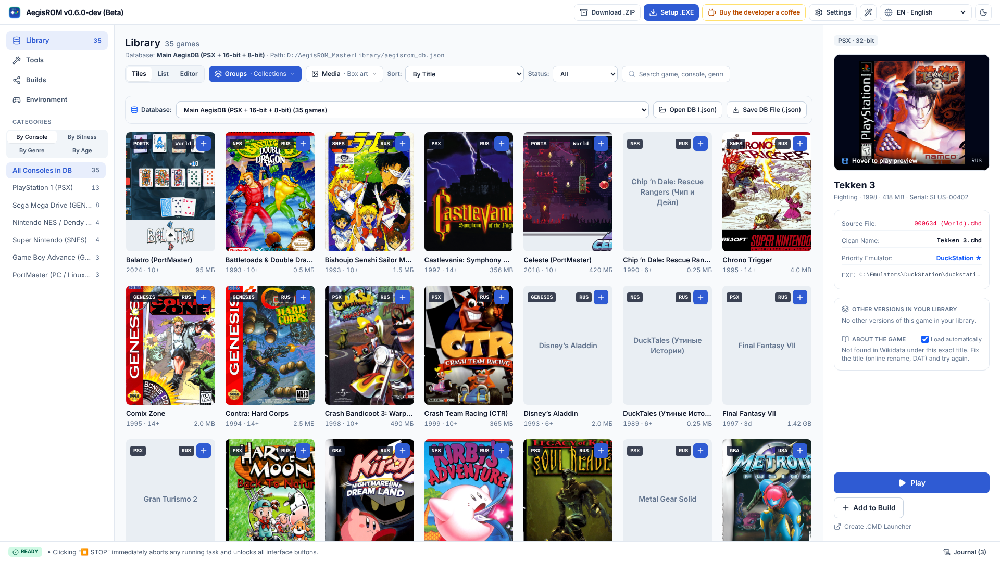

## Возможности

### 📚 Библиотека
- Три режима окна: **Плитки** (витрина с обложками), **Список** (плотный список) и **Редактор** (сравнение «было → стало» с галочками для массовых действий).
- Группировка по консолям, поколениям (8-bit, 16-bit, 32/64-bit, 128-bit+), жанрам и годам.
- **Многодисковые игры** (Final Fantasy VII, Metal Gear Solid и т.п.) показываются как одна игра: диски складываются в общую папку, создаётся плейлист `.m3u`.
- Карточка игры с обложкой и видео-превью.
- Добавление игры в сборку одной кнопкой `+`.
- Сохранение и открытие базы библиотеки, чтобы не сканировать диски заново.
- **Коллекции**: одна игра, вышедшая на нескольких консолях, показывается одной группой; в карточке описание игры из Wikidata.
- **Группы и медиа**: фильтр «только коллекции / только серии / без одиночек» в любом сочетании и внутри одной консоли; выбор картинки на карточках (боксарт, скриншот, титульный экран, баннер), у всех карточек один размер, в списке миниатюры.
- **Открытие без полного скана**: если база уже есть, выбор папки только даёт к ней доступ. 1G1R, переименование, скрапер и перенос берут ромы из базы и не читают каждый файл заново.
- **Запуск** `beta`: встроенный эмулятор (EmulatorJS) запускает игру прямо в окне программы, без установки эмуляторов. Для Sega CD и PC Engine CD BIOS берётся из раздела BIOS.
- **Сохранения** `beta`: игра из «Запуска» сохраняется файлами рядом с ромом (`.srm`, `.state`, имена как у RetroArch). В карточке игры видны сохранения, история последних 10 версий с откатом и сохранения из папок эмуляторов. При переименовании, переносе рома или удалении дубля 1G1R сохранения едут за ним.
- **Свои коллекции и серии**: группировка игр вручную, можно вынуть игру из автоматической группы, а после скана принять или отклонить предложения программы (кнопка «Предложения»). Предложения различают серии (разные игры одной линейки) и коллекции (одна игра на нескольких консолях), показывают коллекцию внутри её серии и дают до принятия переименовать группу, сменить её тип и снять лишние игры.
- **Студия**: группировка и сортировка библиотеки по разработчику или издателю.
- **Данные игр в CSV / XML**: выгрузка названий, жанра, года, разработчика, издателя, числа игроков, рейтинга и описания в таблицу, правка и загрузка обратно с предпросмотром каждого изменения. Читается и `gamelist.xml` от ES, ES-DE и Skraper.

| Список | Редактор |
|---|---|
| 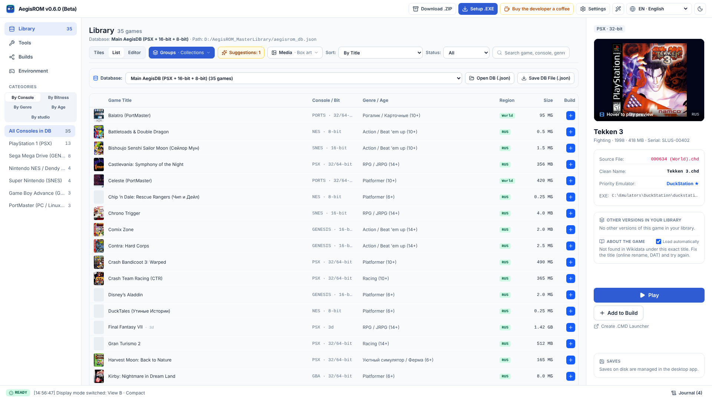 | 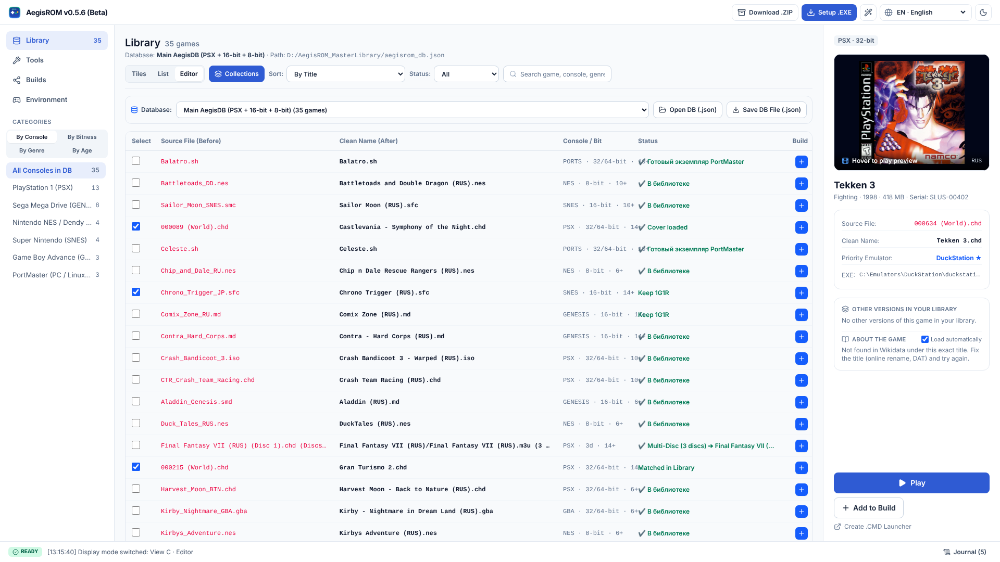 |

| Медиа на карточках | Группы |
|---|---|
| 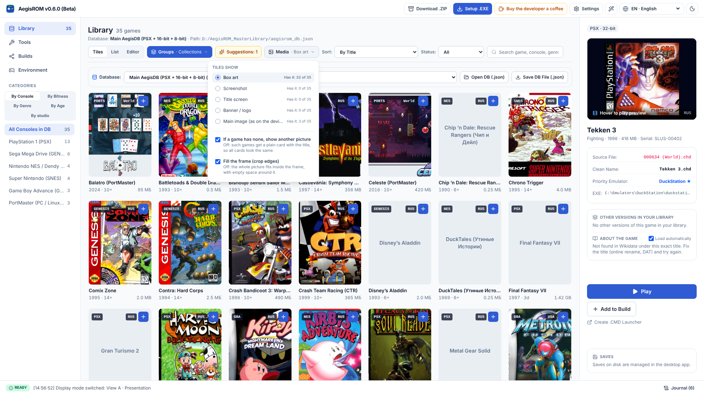 | 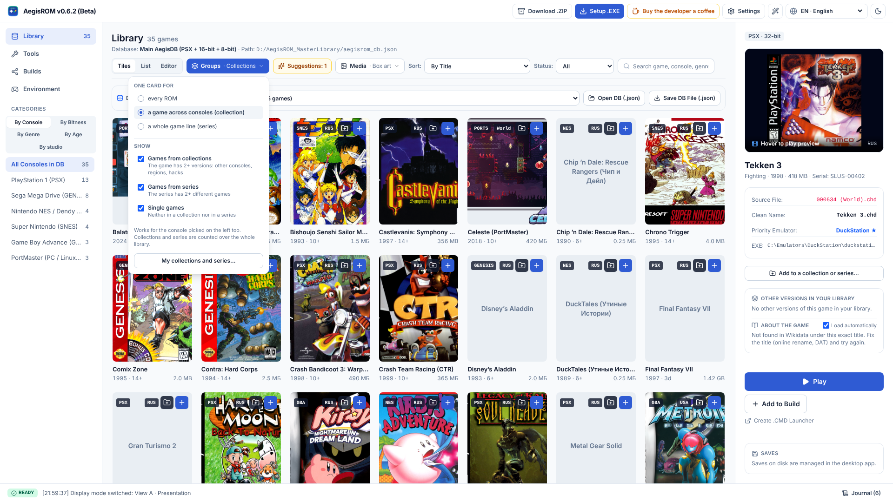 |

| Свои коллекции и серии | Сохранения в карточке |
|---|---|
| 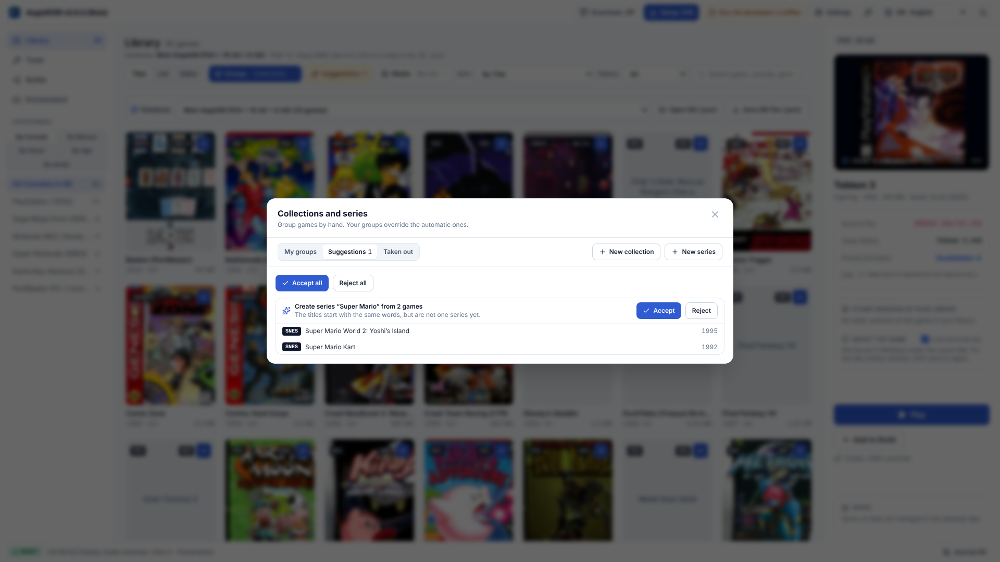 | 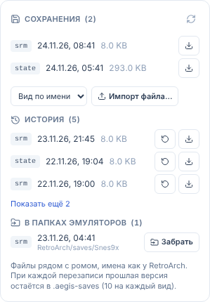 |

> Функции с пометкой `beta` уже есть в программе, но ещё в разработке: могут работать не всегда или не так, как ожидается. Если что-то не так, напишите в [Issues](https://github.com/wirgylle/AegisROM/issues).

### 🛠 Инструменты
- **Сканирование** с распознаванием по CRC32 (в том числе без заголовка рома) и серийным кодам дисков (`SLUS`, `SCES`, `SLPS`).
- **1G1R (одна игра — один ром):** из всех версий игры остаётся лучшая по вашему приоритету регионов, например `Россия → США → Европа → Япония`.
- **Скрапер обложек и видео**: Libretro (каталог libretro-thumbnails на GitHub, кэш на 14 дней), ScreenScraper (по учётной записи screenscraper.fr), Archive.org и готовые медиа из другой программы (папка Skraper, ES-DE, Batocera, RetroBat с `gamelist.xml`: ничего не скачивается и лимитов нет). Перед запуском выбираете источники и их порядок; если источник ничего не нашёл, нет логина или кончился лимит, берётся следующий. Там же выбираете, что качать: боксарт, скриншот, логотип/баннер, видео. Игры без медиа в прошлый раз по умолчанию пропускаются, итог показывает причины промахов. Пустые картинки-заглушки перекачиваются, нормальные файлы не трогаются, медиа многодисковых игр и файлы из `gamelist.xml` больше не удаляются при чистке.
- **Окно «На чём запускать»** для 1G1R, онлайн-переименования и скрапера: консоли, битность, папки, отдельные игры, коллекции и серии, «только без медиа», «только новые».
- **Названия по хешу**: сверка с DAT-файлами No-Intro (картриджи) и Redump (диски) по CRC32 / SHA1, для PBP и больших образов — по серийному номеру. Найденное название главнее онлайн-поиска, источник виден в карточке игры. Как добавить DAT — [docs/dat.md](docs/dat.md).
- **Переименование**: по хешу из DAT, онлайн-поиск, по `gamelist.xml` и по заголовкам ромов. Понимает номерные файлы вида `000001.chd`, как на стоковых флешках R36S.
- **Конструктор имён файлов**: название, регион, язык, автор перевода, номер диска, регистр расширения, тег статуса `[T+Rus]` / `[Hack]`.
- **Хаки и переводы** `beta`: распознаются по тегам (`[T+Rus]`, `[h1]`, `(Hack)`), по хешу из DAT и по патчам из `patch/`. 1G1R не удаляет их как дубли, а предлагает перенести в `hackroms/`. В карточке видно, чем ром отличается от оригинала. Фильтр и сортировка по статусу, сборки «Только русификаторы» и «Без хаков».
- **Патчер ромов** `beta`: IPS, UPS, BPS и xdelta. Ставит тег `[T+Rus]` или `[Hack]`, кладёт результат в `hackroms/`, а патч в `patch/`. Подробно — [docs/hacks.md](docs/hacks.md) · [English](docs/hacks.en.md).
- **Очистка** от мусора: файлы `._*`, лишние картинки, пустые служебные папки.
- **Ремонт флешки** под прошивку: восстановление структуры папок и снятие флага Dirty Bit для **ArkOS, AmberELEC, ROCKNIX, OnionOS, GarlicOS, muOS, Batocera / Knulli, EmuELEC, RetroDeck**.
- **Комбайн**: кладёте новые ромы в папку-буфер, программа сама распознаёт, переименовывает и раскладывает их по папкам консолей.

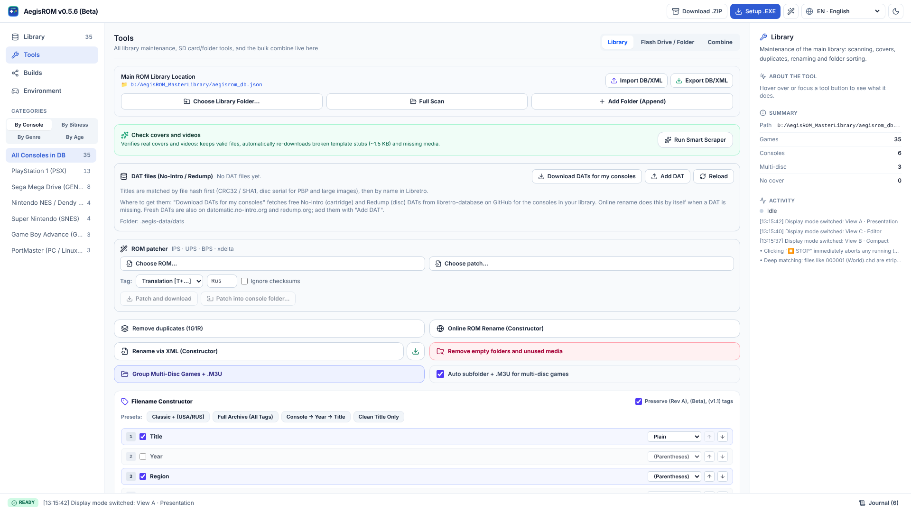

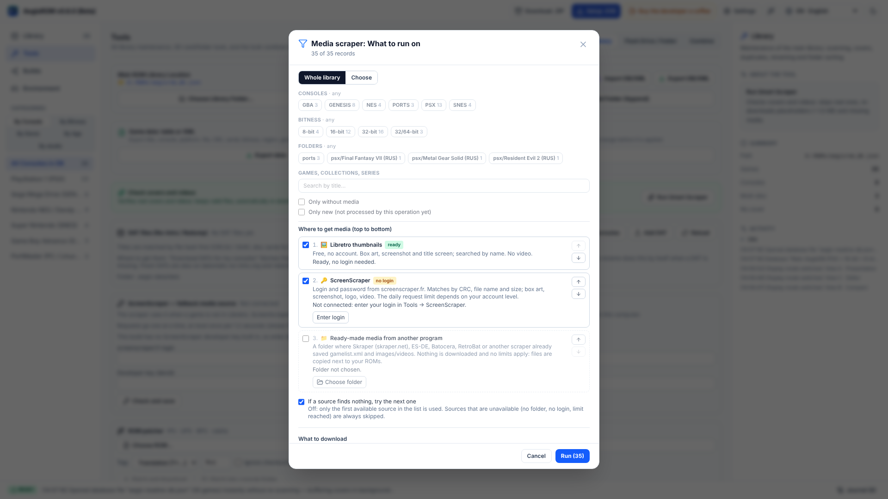

### 📦 Сборки
- Готовые тематические подборки: по возрасту (6+, 10+, 14+, 18+), по настроению, по жанрам и битности. Или своя сборка через фильтры.
- Подгонка под объём флешки: 16, 32, 64, 128, 256 ГБ, с учётом места под прошивку и BIOS.
- Синхронизация сборки с основной библиотекой с показом разницы.
- **Быстрая выгрузка**: ромы копируются по несколько сразу, уже скопированные файлы того же размера пропускаются, поэтому повторная выгрузка докопирует только новое. Медиа (боксарт, картинка, баннер, видео) и `gamelist.xml` с названиями и описаниями едут вместе со сборкой в раскладке под ваше устройство.
- **Заливка по Wi-Fi** `beta`: SFTP или SMB прямо на приставку, без извлечения карты. Едут только новые и изменённые файлы, прерванная заливка докачивается. Готовые профили для ArkOS, muOS, Knulli, Batocera, Onion, TrimUI и Steam Deck; пароли хранятся в системном хранилище паролей. Подробнее — [docs/wifi-transfer.md](docs/wifi-transfer.md).
- **Сохранения со сборкой**: при выгрузке в папку или на SD-карту сохранения едут вместе с ромами, а более новые сохранения с карты возвращаются обратно.
- **Конвертер образов**: `.cue/.bin`, `.iso`, `.gdi` → `.chd` (через `chdman`), а также `.pbp` и `.cso`.
- **Каталог PortMaster** `beta`: список портов с фильтром «готово к запуску» / «нужны файлы из Steam или GOG» и автоматической раскладкой в `ports/`.

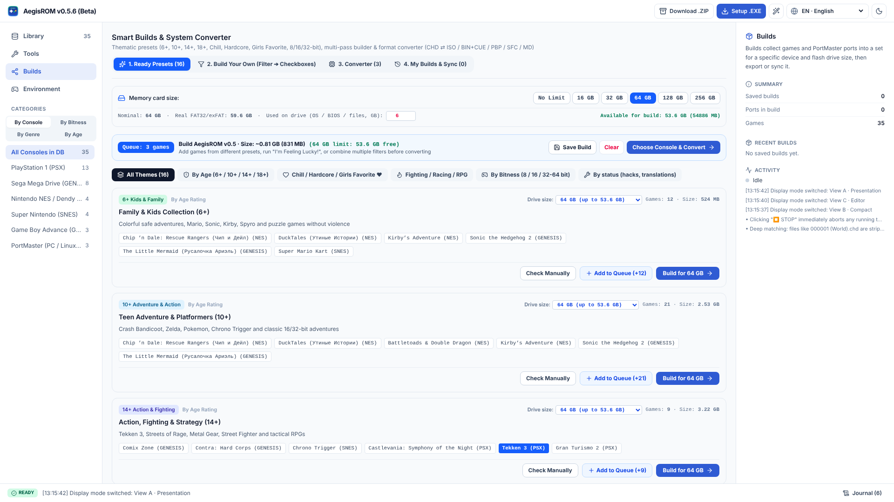

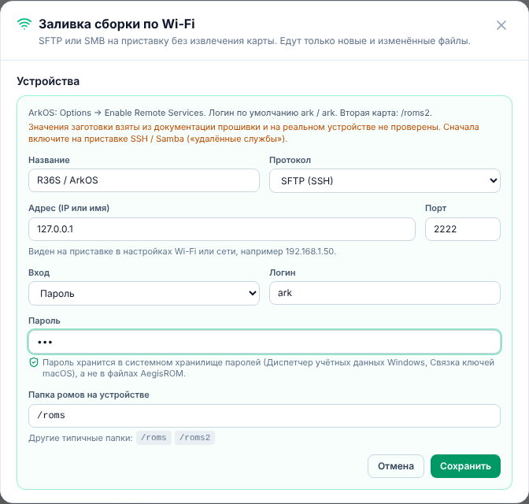

### 🎮 Среда
- Выбор эмулятора для каждой платформы: ядра RetroArch, DuckStation, PCSX2, RPCS3, PPSSPP, mGBA, melonDS, Ryujinx, Xemu.
- Автопоиск установленных эмуляторов на ПК и запуск игры прямо из карточки `beta`.
- Проверка портов PortMaster на ПК перед копированием на консоль `beta`.
- **BIOS**: справочник для новичков, какие файлы нужны каждой консоли, проверка по MD5 из базы libretro и копирование BIOS в сборку.

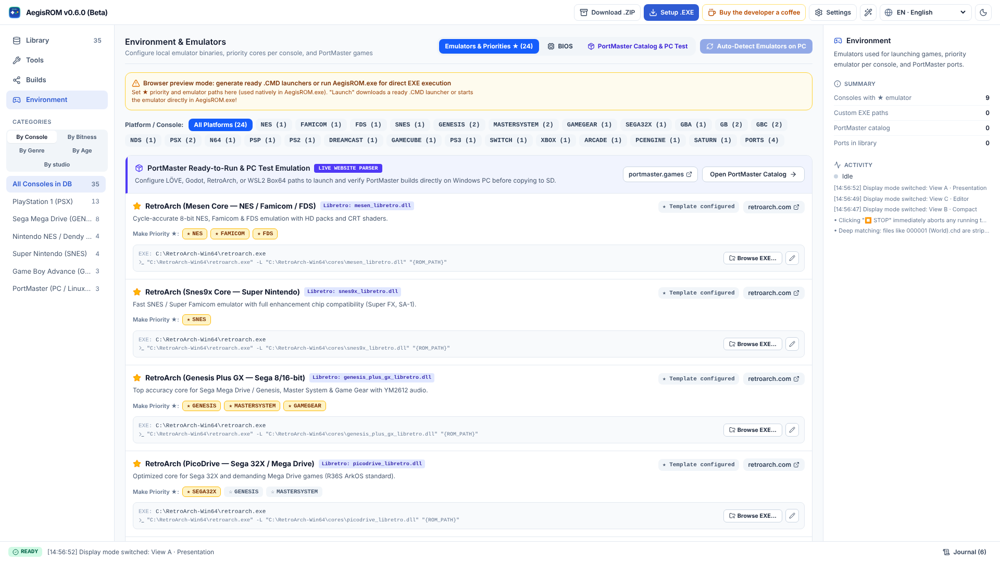

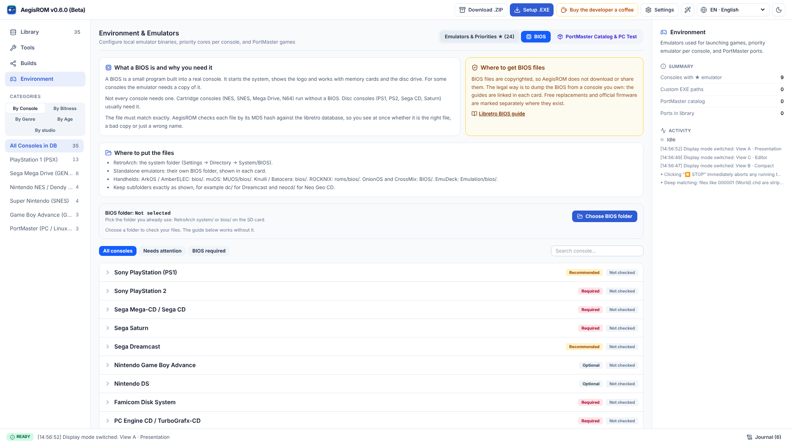

### ⚙️ Настройки
Кнопка «Настройки» в шапке: тема (светлая, тёмная или как в системе), язык, раздел и вид библиотеки при запуске, сортировка, приоритет 1G1R, переименование при сортировке, скрапер, удаление дублей, комбайн и флешка. Эти значения применяются при каждом запуске, переключатели внутри разделов меняют только текущий сеанс.

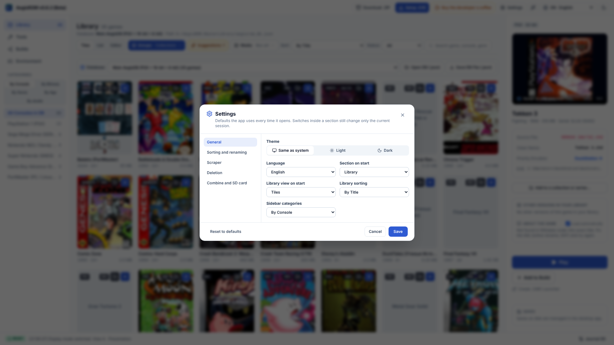

### 🌍 9 языков интерфейса
Русский, English, Deutsch, Español, Français, Italiano, 日本語, Srpski (латиница), 简体中文. Язык определяется автоматически, переключатель в шапке.

## Системные требования

| | |
|---|---|
| ОС | Windows 11 x64; macOS 11 или новее `beta` |
| Браузер (Windows) | Microsoft Edge или Google Chrome (окно программы открывается через него) |
| Для конвертации в `.chd` | `chdman` из комплекта MAME |
| Интернет | нужен только для скрапера обложек и каталога PortMaster |

Версия для macOS (один `.dmg` для Intel и Apple Silicon) появилась в 0.6.0, на настоящем Mac её ещё не проверяли. Она не подписана Apple, поэтому первый запуск macOS заблокирует; как открыть — [docs/macos.md](docs/macos.md). Версии для Linux пока нет.

## Установка

1. Откройте страницу [Releases](https://github.com/wirgylle/AegisROM/releases) и выберите верхний (самый новый) релиз.
2. Скачайте один из файлов:

| Файл | Что это |
|---|---|
| `AegisROM-Setup-vX.Y.Z-Win11-x64.exe` | **Установщик.** Рекомендуется. Ставит в `C:\Program Files\AegisROM`, создаёт ярлыки, удаляет старые копии, переносит настройки. |
| `AegisROM-Portable-Win11-x64.exe` | **Портативная версия** в одном файле, без установки. |
| `AegisROM-vX.Y.Z-Win11-x64.zip` | Полный архив со всеми компонентами. |
| `aegis-scanner-win11-x64.exe` | Отдельный консольный сканер для продвинутых пользователей. |
| `AegisROM-vX.Y.Z-macOS-universal.dmg` | **macOS** `beta`, Intel и Apple Silicon. Перетащите AegisROM в «Программы». |

3. Запустите установщик и следуйте шагам мастера.

> Windows SmartScreen может предупредить о неизвестном издателе: файлы пока не подписаны. Нажмите «Подробнее» → «Выполнить в любом случае».

Удалить программу можно через «Параметры → Приложения» или деинсталлятор в папке установки.

## Быстрый старт

1. **Укажите папку с ромами.** «Инструменты» → «Библиотека» → выберите папку и запустите сканирование.
2. **Настройте приоритет регионов** и запустите **1G1R**, чтобы убрать дубли.
3. **Переименуйте файлы** через конструктор имён, если нужно единое оформление.
4. **Запустите скрапер**, чтобы скачать обложки и видео.
5. **Соберите флешку.** «Сборки» → создайте сборку под объём карты, добавьте игры кнопкой `+` в библиотеке и выгрузите на SD-карту.
6. Если консоль не видит карту или ругается на ошибки, используйте **«Ремонт флешки»** с профилем вашей прошивки.

## FAQ

**Где взять ромы?**
AegisROM не скачивает и не распространяет игры. Используйте копии игр, которыми вы владеете.

**Программа удаляет файлы?**
По умолчанию дубли после 1G1R переносятся в папку-карантин `_Duplicates_1G1R`, а не удаляются. Безвозвратное удаление включается отдельной галочкой.

**Моя флешка с R36S называется `000001.chd`, `000002.chd`… Это поддерживается?**
Да. Переименование по `gamelist.xml` и заголовкам разбирает такие номерные файлы и возвращает им нормальные названия.

**Где взять DAT-файлы для сверки по хешу?**
Нажмите «Скачать DAT для моих консолей» в «Инструментах»: AegisROM скачает DAT No-Intro и Redump из libretro-database для консолей вашей библиотеки. Онлайн-переименование делает это само, если DAT нет. Можно и вручную: [datomatic.no-intro.org](https://datomatic.no-intro.org) (картриджи) и [redump.org](http://redump.org/downloads/) (диски), затем кнопка «Добавить DAT». Подробнее — [docs/dat.md](docs/dat.md).

**Нужен ли интернет?**
Только для скачивания обложек, видео и каталога PortMaster. Сканирование, 1G1R, переименование и сборки работают офлайн.

**Есть версия для Linux / macOS / Steam Deck?**
macOS: да, с 0.6.0, как `beta`, на настоящем Mac её ещё не проверяли. Linux и Steam Deck в планах.

**Нашёл ошибку или есть идея.**
Создайте [Issue](https://github.com/wirgylle/AegisROM/issues) и опишите, что делали и что произошло. Скриншот сильно помогает.

## Планы

| Версия | Что появится |
|---|---|
| **0.6.0** (вышла) | Сохранения рядом с ромом с историей, сохранения едут за ромом и со сборкой. Заливка по Wi-Fi (SFTP / SMB). Версия для macOS `beta`. Свои коллекции и серии с предложениями, группировка по студии, данные игр в CSV / XML. Выбор источника скрапера (Libretro, ScreenScraper, папка Skraper / ES-DE), окно настроек и тема как в системе, быстрая выгрузка сборки с медиа и `gamelist.xml`. |
| **0.5.6** (вышла) | Модуль хаков и патчей с патчером IPS/UPS/BPS/xdelta, раздел BIOS с проверкой по MD5, запуск игр в окне программы, мастер первой настройки и тур, коллекции в библиотеке, настройки на диске. |
| **0.5.7 – 0.5.8** | Ручная правка в режиме «Редактор» (название, данные, пути к медиа), Серии в библиотеке (вся линейка игры), точнее онлайн-переименование, сжатые xdelta-патчи. |
| **0.6.x** | Сохранения по Wi-Fi, заливка по WebDAV, проверка macOS и заливки по Wi-Fi на настоящих устройствах. Своё окно программы вместо Edge или Chrome. PortMaster на Windows через виртуальную среду Linux (WSL). |
| **0.7.0** | RetroAchievements: проверка поддержки достижений по хешу рома. PDF-мануалы, карты прохождения и плеер саундтреков в карточке игры. |
| **после 1.0** | После перехода на схему «сервер + клиент»: стриминг на локальные медиасерверы вроде Plex и Kodi, игра в браузере и готовый сервер по подписке. |

Подробнее — в [docs/ROADMAP.md](docs/ROADMAP.md). Планы могут меняться.

## Поддержать разработчика

AegisROM бесплатный. Если программа экономит вам время, можно угостить разработчика кофе: кнопка ☕ в шапке программы открывает окно с адресами и QR-кодами. Можно отправить USDT и напрямую:

| Сеть | Адрес USDT |
|---|---|
| Tron (TRC-20) | `TJZJ6wqa3DSmN4JT4ndqYx2MGpqdsVxTE1` |
| Solana (SPL) | `DFV4HD6SCkFTEvtf5xU1mB7DTE5cKMBBHGftpLFWPG1s` |
| Arbitrum One, Avalanche C-Chain, Ethereum (ERC-20) | `0x2a959B2f486e7F1d033016A7c94796cF42e1eF0f` |

Отправляйте только USDT и выбирайте в кошельке или на бирже ту же сеть, что в таблице. Монеты, отправленные в другой сети, пропадут.
<!-- Адреса: источник src/data/donate.ts, тест src/data/donate.test.ts сверяет с ним эту таблицу. -->

## Для разработчиков

Сборка из исходников, архитектура и правила участия описаны в [docs/](docs/) и [CONTRIBUTING.md](CONTRIBUTING.md).

## Лицензия

Лицензия пока не выбрана. До её появления все права на код принадлежат автору.
