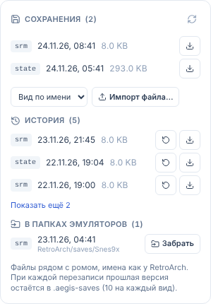

# Сохранения рядом с ромом / Saves next to the ROM

[Русский](#русский) · [English](#english)

## Русский

Первый шаг менеджера сохранений (0.6.0, план — [plan-0.6.0.md](plan-0.6.0.md)). Работает в десктоп-версии (окно Edge и окно Wails): там есть локальный Go API, который знает, где лежит ром.

### Что происходит
- При «Запуске» игры в окне программа ищет рядом с ромом файл `<имя рома>.srm` и загружает его в эмулятор. Игра перезапускается один раз, чтобы увидеть сохранение с самого начала.
- Пока игра идёт, SRAM (сохранения самой игры, у PS1 — карта памяти) пишется в `<имя рома>.srm` каждые 30 секунд и при закрытии окна запуска. Если содержимое не изменилось, файл не трогается.
- Кнопки плеера «Сохранить состояние» и «Загрузить состояние» работают с файлом `<имя рома>.state` рядом с ромом. «Экспорт файла сохранения» тоже пишет `.srm` на диск.
- Перед перезаписью прежний файл копируется в `<папка рома>/.aegis-saves/<имя рома>/<дата-время>.srm` (или `.state`). Хранятся 10 последних версий каждого вида.

Пример:

```text
snes/
├── Chrono Trigger (USA).sfc
├── Chrono Trigger (USA).srm
├── Chrono Trigger (USA).state
└── .aegis-saves/
    └── Chrono Trigger (USA)/
        ├── 20261120-131830.srm
        └── 20261120-125512.srm
```

Имена такие же, как у RetroArch, когда он хранит сохранения в папке игры. Для образов `.cue` сохранение называется по `.cue`.

### Совместимость
- `.srm` — тот же формат, что у RetroArch с тем же ядром: его можно унести на приставку.
- `.state` — снимок ядра EmulatorJS (это ядра libretro). RetroArch откроет его только с той же версией ядра, поэтому переносить состояния на приставку не обещаем.

### Переименование, 1G1R и замена версии (шаг 2)
- Сохранения считаются по имени рома: `<имя><суффикс>`, где суффикс — `.srm`, `.sav`, `.rtc`, `.dsv`, `.eep`, `.fla`, `.sra`, `.mpk`, `.mcr`, `.mcd`, `_1.mcd`, `_2.mcd`, `.state`, `.state1`–`.state9`, `.state.auto`.
- При любом переименовании или переносе рома (переименование по номеру и онлайн, сортировка, «Сортировать по правилам», XML-маппинг, перенос в `hackroms/`, массовый перенос, буфер) сохранения и папка истории `.aegis-saves/<имя>/` едут вместе с ним. Перед переносом каждое сохранение копируется в историю.
- 1G1R и замена версии (JP → RU): сохранения убранного дубля переезжают к оставленной версии. Если у неё уже есть своё сохранение, текущим остаётся более новое по времени, второе лежит в истории. Если оставленную версию не найти, сохранения уезжают вместе с дублем в `_Duplicates_1G1R/`.
- Скан считает сохранения рядом с ромами и пишет итог в журнал.
- То же самое делает Go-часть (`aegiscore/saves.go`, `MoveRomSaves`) для старого окна и сканера.

### Блок «Сохранения» в карточке (шаг 3)


- Текущие файлы с датой и размером, экспорт каждого.
- Импорт файла: вид берётся по имени (`.sav`, `.srm`…) или выбирается вручную. Текущий файл сначала уходит в историю.
- История: последние версии каждого вида, «Восстановить» (текущий файл уходит в историю) и скачать.
- «В папках эмуляторов»: сохранения этой игры (то же имя) в `saves/`, `states/`, `memcards/` эмуляторов из «Среды» (и их подпапках ядер), плюс `Документы/DuckStation`, `Документы/PCSX2`. «Забрать» копирует рядом с ромом. Общие карты PS2 (`*.ps2`) только показываются.
- Работает в десктоп-версии. В браузере блок показывает, сколько сохранений нашёл скан.

### Сохранения со сборкой (шаг 7, выгрузка в папку или на SD)
- Галочка «Сохранения едут со сборкой» в окне выгрузки (включена по умолчанию).
- Игровые сохранения (без `.state*`) копируются рядом с ромом на устройство. При следующей выгрузке сохранение, которое новее, забирается обратно в библиотеку. Конфликт решается по времени, обе версии остаются в истории библиотеки. На устройство история не пишется.
- Многодисковые игры пока не синхронизируются: RetroArch называет их сохранения по `.m3u`.
- Выгрузка по Wi-Fi (шаги 5–6) делается отдельно и может вызвать ту же функцию `syncRomSavesWithDevice`.

### Без десктоп-версии
В браузере без Go API сохранения остаются в профиле браузера, как раньше (подпись внизу окна запуска об этом говорит).

### Для разработчиков
- Go: `aegiscore/saves.go` (суффиксы, история, `MoveRomSaves`), `aegisapi/saves.go` — `GET/PUT /api/native/saves?kind=srm|state` или `?suffix=.sav`, `GET /saves/list`, `GET /saves/history?name=`, `POST /saves/restore?name=`, `GET /saves/external?emu=…`, `POST /saves/import-external?path=&emu=…` (путь принимается, только если его же находит `/external` для этого рома). Поля рома те же, что у `/api/native/fs/rom`. Размер до 64 МБ. Тесты: `go test ./aegiscore/ ./aegisapi/`.
- Фронт: `src/utils/saveFiles.ts` (`carryRomSaves`, `syncRomSavesWithDevice`, тесты рядом), блок `src/components/RomSavesPanel.tsx`.
- Плеер: `public/quicktest/player.js` (сообщения `aegis-qt-save`, `aegis-qt-need-state`, `aegis-qt-state`, `aegis-qt-flush`).
- Окно: `src/components/QuickTestModal.tsx`, утилиты `src/utils/romSaves.ts`.

## English

First step of the save manager (0.6.0, plan: [plan-0.6.0.md](plan-0.6.0.md)). Works in the desktop app (Edge window and Wails window), where the local Go API knows where the ROM lives.

### What happens
- When you press Play, the app looks for `<rom name>.srm` next to the ROM and loads it into the emulator. The game resets once so it sees the save from boot.
- While playing, SRAM (the game's own saves; for PS1 the memory card) is written to `<rom name>.srm` every 30 seconds and when you close the Play window. Unchanged content is not rewritten.
- The player's Save State and Load State buttons use `<rom name>.state` next to the ROM. Export Save File also writes `.srm` to disk.
- Before an overwrite the previous file is copied to `<rom folder>/.aegis-saves/<rom name>/<date-time>.srm` (or `.state`). The 10 newest versions of each kind are kept.

Names match RetroArch when it keeps saves in the content folder. For `.cue` images the save is named after the `.cue`.

### Compatibility
- `.srm` has the same format as RetroArch with the same core, so it can go to a handheld.
- `.state` is an EmulatorJS core snapshot (libretro cores). RetroArch opens it only with the same core version, so we do not promise moving states to a handheld.

### Rename, 1G1R and version replacement (step 2)
- Saves are matched by ROM name: `<base><suffix>` with `.srm`, `.sav`, `.rtc`, `.dsv`, `.eep`, `.fla`, `.sra`, `.mpk`, `.mcr`, `.mcd`, `_1.mcd`, `_2.mcd`, `.state`, `.state1`–`.state9`, `.state.auto`.
- Every rename or move of a ROM (numbered and online rename, sorting, sort rules, XML mapping, `hackroms/`, mass move, buffer) carries its saves and the `.aegis-saves/<base>/` history along. Each save is copied into history first.
- 1G1R and version replacement (JP → RU): a removed duplicate's saves move to the kept version. If it already has its own save, the newer one by time stays current and the other goes to history. If the kept version is unknown, saves go with the duplicate into `_Duplicates_1G1R/`.
- The scan counts saves next to ROMs and logs a summary.
- The Go side does the same (`aegiscore/saves.go`, `MoveRomSaves`) for the classic window and the scanner.

### Saves block in the game card (step 3)
- Current files with date and size, export each.
- Import a file: type by name or picked by hand; the current file goes to history first.
- History: recent versions of each type, Restore (current goes to history) and download.
- "In emulator folders": this game's saves (same name) in `saves/`, `states/`, `memcards/` of emulators from Environment (and core subfolders), plus `Documents/DuckStation` and `Documents/PCSX2`. Take copies it next to the ROM. Shared PS2 cards (`*.ps2`) are listed only.
- Desktop app only; in a browser the block shows how many saves the scan found.

### Saves with a build (step 7, export to a folder or SD)
- "Saves travel with the build" checkbox in the export dialog (on by default).
- Game saves (no `.state*`) are copied next to the ROM on the device. On the next export the newer save comes back to the library; conflicts are resolved by time and both versions stay in the library history. No history is written to the device.
- Multi-disc games are not synced yet: RetroArch names their saves after the `.m3u`.
- Wi-Fi upload (steps 5–6) is a separate task and can call the same `syncRomSavesWithDevice`.

### Without the desktop app
In a browser without the Go API, saves stay in the browser profile as before (the note at the bottom of the Play window says so).

### For developers
- Go: `aegiscore/saves.go` (suffixes, history, `MoveRomSaves`), `aegisapi/saves.go` — `GET/PUT /api/native/saves?kind=srm|state` or `?suffix=.sav`, `GET /saves/list`, `GET /saves/history?name=`, `POST /saves/restore?name=`, `GET /saves/external?emu=…`, `POST /saves/import-external?path=&emu=…` (the path is accepted only if `/external` finds it for this ROM). ROM fields are the same as for `/api/native/fs/rom`. Up to 64 MB. Tests: `go test ./aegiscore/ ./aegisapi/`.
- Frontend: `src/utils/saveFiles.ts` (`carryRomSaves`, `syncRomSavesWithDevice`, tests next to it), block `src/components/RomSavesPanel.tsx`.
- Player: `public/quicktest/player.js` (messages `aegis-qt-save`, `aegis-qt-need-state`, `aegis-qt-state`, `aegis-qt-flush`).
- Window: `src/components/QuickTestModal.tsx`, helpers `src/utils/romSaves.ts`.
