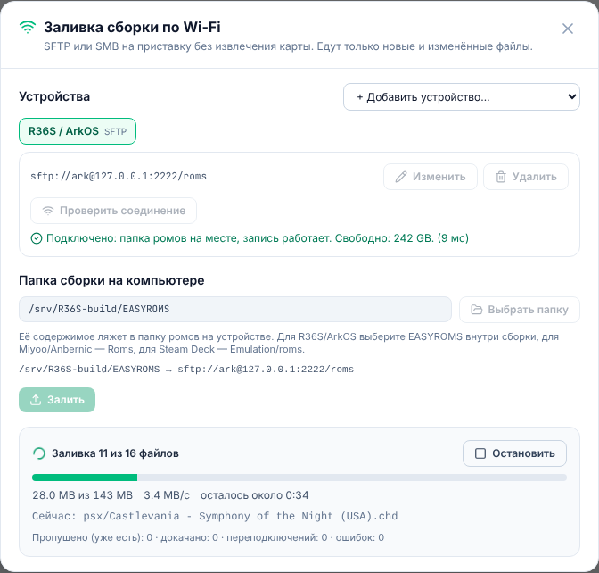
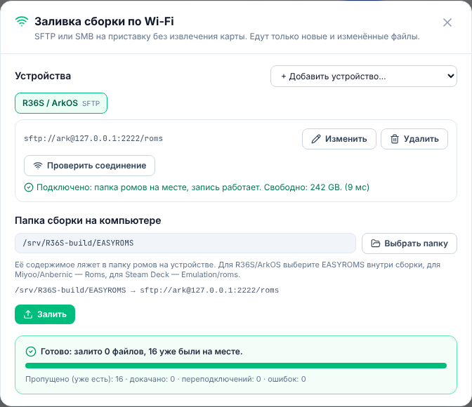

# Заливка по Wi-Fi / Wi-Fi upload

[Русский](#русский) · [English](#english)

## Русский

Задачи 5 и 6 из [plan-0.6.0.md](plan-0.6.0.md): сборка заливается на приставку по SFTP или SMB без извлечения карты.

### Как это работает
1. Сборка выгружается в папку на диске как раньше («Выгрузить сборку»).
2. «Сборки» → «3. Конвертер» → **«Залить по Wi-Fi»**. Если сборку только что выгрузили в папку через Go (нативное окно), папка подставляется сама: для R36S/ArkOS это `EASYROMS`, для Miyoo/Anbernic `Roms`, для Steam Deck `Emulation/roms`.
3. Go (`aegistransfer/`) зеркалит содержимое папки в папку ромов на устройстве.

### Что заливается
- Файл едет, если его нет на устройстве, размер другой или локальный новее (допуск 2 с для FAT/exFAT). После заливки время файла на устройстве ставится как у исходника, поэтому повторная заливка пропускает готовое.
- Пишется сначала `имя.aegis-part`, потом переименовывается. Оборванный файл докачивается с места обрыва, если кусок новее локального файла (иначе он от старой версии и заливается заново).
- При обрыве связи 3 переподключения (через 2, 5 и 10 с). Перед заливкой проверяется свободное место.
- Не заливаются `Thumbs.db`, `desktop.ini`, `.DS_Store`, `._*`, папки `.aegis*` (в том числе `.aegis-saves`).
- Файлы на устройстве не удаляются.

### Профили и безопасность
- Профили: `appDir/transfer-profiles.json` (без паролей). Пароли: Диспетчер учётных данных Windows / Связка ключей macOS / Secret Service в Linux (`go-keyring`). Если хранилища нет (Linux без GNOME Keyring/KWallet), пароль не сохраняется, понятная ошибка; можно входить по SSH-ключу.
- SFTP: отпечаток SSH-ключа устройства подтверждает пользователь при первой проверке; если ключ изменился, заливка не идёт, пока его не подтвердят заново. Смена адреса сбрасывает отпечаток.
- Папка сборки должна быть выбрана в нативном диалоге (`/api/native/vfs/pick`), произвольный путь API не примет.
- Заготовки (R36S/ArkOS, Anbernic/muOS, Knulli, TrimUI, Steam Deck, Batocera/Knulli SMB, Miyoo/Onion SMB) взяты из документации прошивок и **на устройствах не проверены**.

### API
`/api/native/transfer/presets`, `profiles` (GET/POST/DELETE), `test`, `start`, `status`, `cancel`. Одна заливка за раз.

### Не сделано
- WebDAV (часть задачи 6).
- Сохранения вместе со сборкой (задача 7, после сохранений шаг 2).
- В браузерной версии без Go заливки нет.

### Проверено
- Go-тесты: свой SFTP-сервер в тесте (полная заливка, пропуск, докачка, устаревший кусок, ключ устройства, неверный пароль, закрытый порт, нет папки), обрыв с переподключением, отмена, профили.
- SMB на настоящем Samba 4 (гость и пароль): `AEGIS_SMB_TEST=127.0.0.1:4450 … go test ./aegistransfer -run SMB`.
- Окно в Chromium против SFTP-сервера с ограничением 4 МБ/с (скриншоты выше). На Windows и на R36S не проверено.

## English

Tasks 5 and 6 of [plan-0.6.0.md](plan-0.6.0.md): push a build to a handheld over SFTP or SMB without taking the card out.

### How it works
1. Export the build to a folder on disk as before.
2. Builds → 3. Converter → **Upload over Wi-Fi**. If the build was just exported to a Go-backed folder (native window), the folder is filled in: `EASYROMS` for R36S/ArkOS, `Roms` for Miyoo/Anbernic, `Emulation/roms` for Steam Deck.
3. Go (`aegistransfer/`) mirrors the folder contents into the ROM folder on the device.

### What gets uploaded
- A file is sent when it is missing on the device, its size differs, or the local one is newer (2 s slack for FAT/exFAT). The device copy gets the source mtime, so the next run skips it.
- Data goes to `name.aegis-part` first and is renamed when complete. An interrupted file resumes from where it stopped if the part is newer than the local file.
- 3 reconnects on a dropped connection (after 2, 5, 10 s). Free space is checked before uploading.
- Skipped: `Thumbs.db`, `desktop.ini`, `.DS_Store`, `._*`, `.aegis*` folders. Nothing is deleted on the device.

### Profiles and security
- Profiles in `appDir/transfer-profiles.json` without passwords; passwords in Windows Credential Manager / macOS Keychain / Secret Service (`go-keyring`). No store means a clear error; SSH keys work too.
- SFTP host key fingerprint is confirmed by the user on first test; a changed key blocks uploads until confirmed again. Changing the address resets it.
- The build folder must be picked in the native dialog; the API refuses other paths.
- Presets come from firmware docs and are **not checked on devices**.

### Not done
WebDAV (part of task 6), saves with builds (task 7), uploads in the browser-only version.

### Tested
Go tests with an in-test SFTP server, a flaky remote for reconnects, a real Samba 4 for SMB; the window in Chromium against a 4 MB/s SFTP server. Not tested on Windows or a real R36S.
