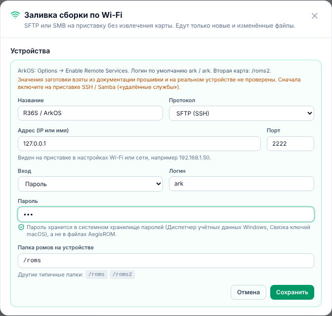
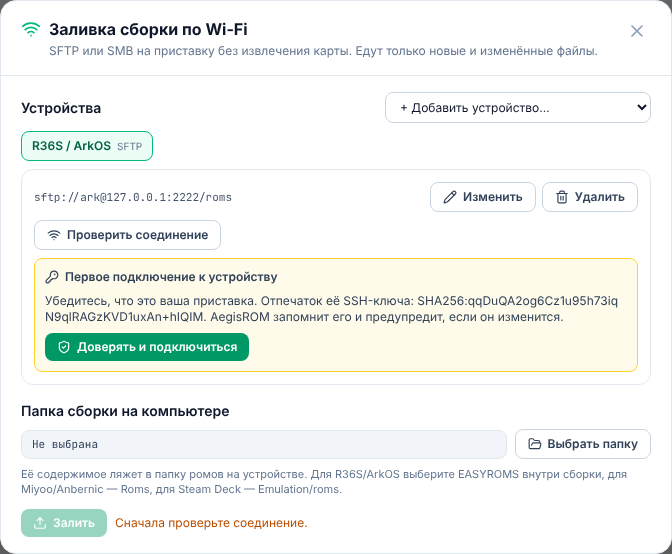
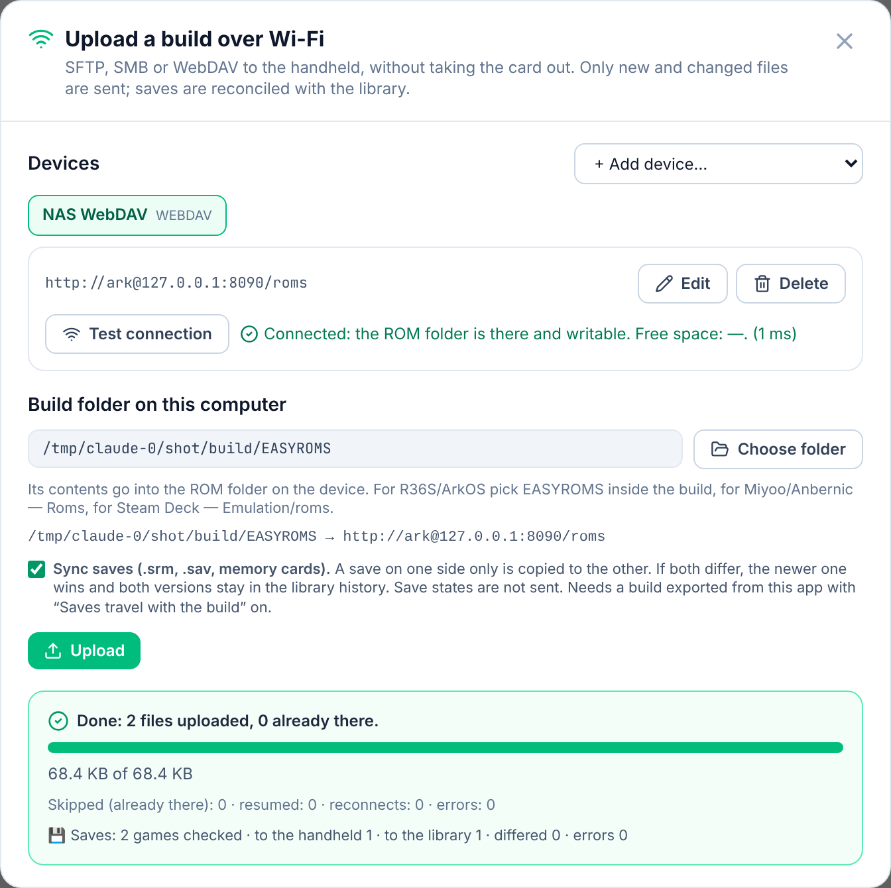

# Заливка по Wi-Fi / Wi-Fi upload

[Русский](#русский) · [English](#english)

## Русский

Задачи 5, 6 и 7 (по сети) из [plan-0.6.0.md](plan-0.6.0.md): сборка заливается на приставку по SFTP, SMB или WebDAV без извлечения карты, сохранения сверяются с библиотекой.

### Как это работает
1. Сборка выгружается в папку на диске как раньше («Выгрузить сборку»).
2. «Сборки» → «3. Конвертер» → **«Залить по Wi-Fi»**. Если сборку только что выгрузили в папку через Go (нативное окно), папка подставляется сама: для R36S/ArkOS это `EASYROMS`, для Miyoo/Anbernic `Roms`, для Steam Deck `Emulation/roms`.
3. Go (`aegistransfer/`) зеркалит содержимое папки в папку ромов на устройстве.

### Что заливается
- Файл едет, если его нет на устройстве, размер другой или локальный новее (допуск 2 с для FAT/exFAT). После заливки время файла на устройстве ставится как у исходника, поэтому повторная заливка пропускает готовое.
- Пишется сначала `имя.aegis-part`, потом переименовывается. Оборванный файл докачивается с места обрыва, если кусок новее локального файла (иначе он от старой версии и заливается заново).
- При обрыве связи 3 переподключения (через 2, 5 и 10 с). Перед заливкой проверяется свободное место.
- Не заливаются `Thumbs.db`, `desktop.ini`, `.DS_Store`, `._*`, файлы и папки `.aegis*` (в том числе `.aegis-saves` и `.aegis-saves-map.json`).
- Файлы на устройстве не удаляются.

### WebDAV
- Протокол «WebDAV (HTTP)»: адрес и порт (80, с галочкой HTTPS — 443), путь к папке ромов на сервере (например, `/roms` или `/dav/roms`). Вход: гость, Basic или Digest.
- HTTPS только с действительным сертификатом: самоподписанный сертификат не примется.
- Время файла на WebDAV-сервере выставить нельзя: после заливки там время заливки, оно новее исходника, поэтому повторная заливка файл пропускает.
- Докачки нет: оборванный файл заливается заново (PUT с середины в WebDAV не стандартизован).
- Заготовок под прошивки нет: какая прошивка поднимает WebDAV и с какими путями, не проверено.

### Сохранения по Wi-Fi
- Галочка «Сверять сохранения» в окне (включена по умолчанию). Правила те же, что при выгрузке в папку или на SD: сохранение только с одной стороны копируется на другую; если с обеих сторон разные, текущим становится более новое по времени, а обе версии остаются в истории библиотеки (`.aegis-saves`). На приставку история не пишется. Снимки состояний (`.state*`) не ездят.
- Откуда программа знает, где ром лежит в библиотеке: выгрузка сборки с включённым «Сохранения едут со сборкой» пишет `.aegis-saves-map.json` в корень папки сборки (только для папок через Go). Заливка ищет этот файл в выбранной папке и до трёх папок выше. Папки библиотеки должны быть среди выбранных в программе. Нет файла — сохранения не сверяются, окно об этом пишет.
- Сохранения ищутся рядом с ромом на приставке (`<имя рома>.srm` и т. п., как RetroArch с «сохранениями в папке контента»). Если прошивка кладёт сохранения в отдельную папку (muOS, Batocera `saves/`), они не найдутся.
- Зеркало больше не перезаписывает файл сохранения, который уже есть на приставке: им занимается только сверка.
- Сверка по времени: если на приставке сбиты часы (у R36S нет батарейки часов), «более новое» может определиться неверно. Обе версии всё равно остаются в истории.
- Многодисковые игры (.m3u) не сверяются, как и при выгрузке в папку.

### Профили и безопасность
- Профили: `appDir/transfer-profiles.json` (без паролей). Пароли: Диспетчер учётных данных Windows / Связка ключей macOS / Secret Service в Linux (`go-keyring`). Если хранилища нет (Linux без GNOME Keyring/KWallet), пароль не сохраняется, понятная ошибка; можно входить по SSH-ключу.
- SFTP: отпечаток SSH-ключа устройства подтверждает пользователь при первой проверке; если ключ изменился, заливка не идёт, пока его не подтвердят заново. Смена адреса сбрасывает отпечаток.
- Папка сборки должна быть выбрана в нативном диалоге (`/api/native/vfs/pick`), произвольный путь API не примет.
- Заготовки (R36S/ArkOS, Anbernic/muOS, Knulli, TrimUI, Steam Deck, Batocera/Knulli SMB, Miyoo/Onion SMB) взяты из документации прошивок и **на устройствах не проверены**.

### API
`/api/native/transfer/presets`, `profiles` (GET/POST/DELETE), `test`, `start` (`syncSaves`), `status`, `cancel`. Одна заливка за раз.

### Не сделано
- В браузерной версии без Go заливки нет.
- Сохранения в отдельной папке прошивки (не рядом с ромом).

### Проверено
- Go-тесты: свой SFTP-сервер в тесте (полная заливка, пропуск, докачка, устаревший кусок, ключ устройства, неверный пароль, закрытый порт, нет папки), обрыв с переподключением, отмена, профили.
- SMB на настоящем Samba 4 (гость и пароль): `AEGIS_SMB_TEST=127.0.0.1:4450 … go test ./aegistransfer -run SMB`.
- WebDAV: Go-тесты против сервера `golang.org/x/net/webdav` (без входа, Basic, Digest; имена с пробелами, `#` и `%`; повтор пропускает; неверный пароль; нет папки; закрытый порт; не WebDAV-сервер). Окно в Chromium против такого же сервера (скриншот выше).
- Сохранения: Go-тесты по всем случаям (только в библиотеке, только на приставке, конфликт в обе стороны, одинаковые, снимки состояний, ром не залит, зеркало не затирает) через локальную папку и через WebDAV, API-тест со связями и отказом для невыбранной папки.
- Окно в Chromium против SFTP-сервера с ограничением 4 МБ/с (скриншоты выше). На Windows и на реальной приставке не проверено.

## English

Tasks 5, 6 and 7 (network part) of [plan-0.6.0.md](plan-0.6.0.md): push a build to a handheld over SFTP, SMB or WebDAV without taking the card out; saves are reconciled with the library.

### How it works
1. Export the build to a folder on disk as before.
2. Builds → 3. Converter → **Upload over Wi-Fi**. If the build was just exported to a Go-backed folder (native window), the folder is filled in: `EASYROMS` for R36S/ArkOS, `Roms` for Miyoo/Anbernic, `Emulation/roms` for Steam Deck.
3. Go (`aegistransfer/`) mirrors the folder contents into the ROM folder on the device.

### What gets uploaded
- A file is sent when it is missing on the device, its size differs, or the local one is newer (2 s slack for FAT/exFAT). The device copy gets the source mtime, so the next run skips it.
- Data goes to `name.aegis-part` first and is renamed when complete. An interrupted file resumes from where it stopped if the part is newer than the local file.
- 3 reconnects on a dropped connection (after 2, 5, 10 s). Free space is checked before uploading.
- Skipped: `Thumbs.db`, `desktop.ini`, `.DS_Store`, `._*`, `.aegis*` files and folders. Nothing is deleted on the device.

### WebDAV
- "WebDAV (HTTP)": address and port (80, or 443 with HTTPS), the ROM folder path on the server (e.g. `/roms`, `/dav/roms`). Login: guest, Basic or Digest.
- HTTPS needs a valid certificate; self-signed ones are refused.
- The server file time cannot be set: it holds the upload time, which is newer than the source, so the next run skips the file.
- No resume: an interrupted file is sent again. No firmware presets: which firmwares serve WebDAV, and on which paths, is not checked.

### Saves over Wi-Fi
- "Sync saves" in the window (on by default). Same rules as the folder/SD export: one side only — copied over; both and different — the newer by time wins, both versions stay in the library history (`.aegis-saves`). No history on the device, no save states.
- The library location comes from `.aegis-saves-map.json`, written at the build root by an export with "Saves travel with the build" on (Go-backed folders only). The upload looks for it in the chosen folder and up to three folders above. Library folders must be among the folders picked in the app. No file — no save sync, and the window says so.
- Saves are looked up next to the ROM on the handheld (RetroArch "saves in content dir"). Firmwares that keep saves in a separate folder (muOS, Batocera `saves/`) are not covered.
- The mirror no longer overwrites a save that is already on the handheld; only the save step touches it.
- Time-based: a handheld with a wrong clock (R36S has no RTC battery) can pick the wrong "newer" one. Both versions still stay in the history. Multi-disc (.m3u) games are not synced.

### Profiles and security
- Profiles in `appDir/transfer-profiles.json` without passwords; passwords in Windows Credential Manager / macOS Keychain / Secret Service (`go-keyring`). No store means a clear error; SSH keys work too.
- SFTP host key fingerprint is confirmed by the user on first test; a changed key blocks uploads until confirmed again. Changing the address resets it.
- The build folder must be picked in the native dialog; the API refuses other paths.
- Presets come from firmware docs and are **not checked on devices**.

### Not done
Uploads in the browser-only version; saves kept in a separate firmware folder.

### Tested
Go tests with an in-test SFTP server, a flaky remote for reconnects, a real Samba 4 for SMB, an `x/net/webdav` server for WebDAV (guest, Basic, Digest) and for saves; the window in Chromium against a 4 MB/s SFTP server and a WebDAV server. Not tested on Windows or a real handheld.
